# wuji-sim

[](LICENSE)
[](https://github.com/wuji-technology/wuji-sim/releases)

[Chinese version](README_zh.md)

<p>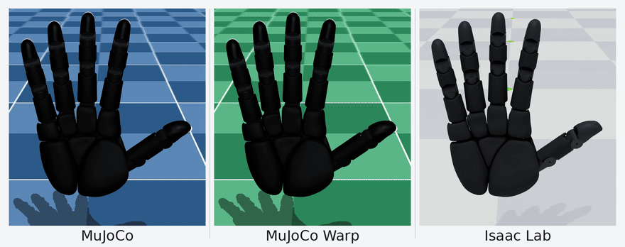</p>

**wuji-sim is the official simulation setup for the Wuji Hand 2.**

Making a simulated hand behave like the real one takes careful configuration. wuji-sim provides a minimal, checked configuration for MuJoCo, MuJoCo Warp and Isaac Lab. The support matrix below shows what is checked on each simulator. Build your own tasks on top of it; more simulators will follow. The Wuji Hand 2 is a five-fingered dexterous hand with 20 actuated joints; its PD gains and joint parameters in this repository are set up to match the real hand under MIT control (see [Control Mode](#control-mode)).

## Table of Contents

- [Support Matrix](#support-matrix)
- [Quick Start](#quick-start)
- [Examples](#examples)
- [Control Mode](#control-mode)
- [Requirements](#requirements)
- [Known Limitations](#known-limitations)
- [Release Notes](#release-notes)
- [Related](#related)
- [Contact](#contact)

## Support Matrix

| | MuJoCo | MuJoCo Warp | Isaac Lab | MotrixSim |
| :--- | :--- | :--- | :--- | :--- |
| Tested with | mujoco 3.11.0 | mujoco-warp 3.11.0, warp-lang 1.17.0 | Isaac Lab 3.0.0, Isaac Sim 6.2.0.0 | motrixsim 1.0.0 |
| Asset | MJCF | MJCF | USD | MJCF |
| Control mode | MIT | MIT | MIT | MIT |
| Kinematics (fingertip position) | Sim-checked | Sim-checked | Sim-checked | Not validated |
| Inertia | Sim-checked | Sim-checked | Sim-checked | Not validated |
| Self-collision (test motions) | Sim-checked | Sim-checked | Sim-checked | Not validated |
| Joint tracking (free space) | Real-to-sim compared | Real-to-sim compared | Real-to-sim compared | Not validated |
| Joint tracking (under load) | Not validated | Not validated | Not validated | Not validated |
| Fingertip force | Not validated | Not validated | Not validated | Not validated |
| Joint torque limits | Not validated | Not validated | Not validated | Not validated |

- **Sim-checked** — checked in simulation only, not on the real hand.
- **Real-to-sim compared** — real-hand recordings are replayed in simulation and the error is reported; there is no pass threshold.
- **Not validated** — not checked yet.

<p>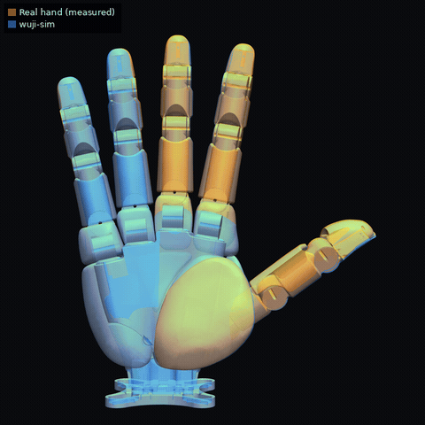</p>

The real right hand (amber) and wuji-sim (blue), both translucent, replay the same commands; where they overlap the colours blend, where they differ they separate.

## Quick Start

### 1. Install

wuji-sim uses [Pixi](https://pixi.sh) 0.84.1 or newer and runs on Linux x86-64 with glibc 2.35 or newer (for
example Ubuntu 22.04 or later). Install the environment of each simulator you need:

```bash
git clone https://github.com/wuji-technology/wuji-sim.git
cd wuji-sim

pixi install --locked -e mujoco        # MuJoCo (CPU)
pixi install --locked -e mujoco-warp   # MuJoCo Warp (NVIDIA GPU)
pixi install --locked -e motrixsim     # MotrixSim (CPU)
pixi install --locked -e isaaclab      # Isaac Lab on Isaac Sim (NVIDIA RTX GPU)
```

Each environment also installs the hand model (`wuji-hand2-2-description`).

### 2. Run one example per simulator

#### MuJoCo

```bash
pixi run -e mujoco python examples/mujoco/01_load_and_view.py --hand right
```

#### MuJoCo Warp

Needs an NVIDIA GPU with CUDA.

```bash
pixi run -e mujoco-warp python examples/mujoco_warp/01_load_and_step.py --hand right
```

#### MotrixSim

```bash
pixi run -e motrixsim python examples/motrixsim/01_load_and_view.py --hand right
```

#### Isaac Lab

Needs an NVIDIA RTX GPU, and Isaac Sim asks you to accept the NVIDIA Omniverse EULA on first launch (see
[Requirements](#requirements)).

```bash
pixi run -e isaaclab python examples/isaaclab/01_load_and_view.py --hand right
```

The examples open a viewer window by default and write a small JSON record of the run; add `--headless` to run
without a window, for automation or on machines without a display, and to also write images, videos and CSV
files. Each run prints `record: <path>.json`. Every run writes a new record named after its start time, so runs never
overwrite each other and nothing needs cleaning up between them. Without `--output-dir`, outputs go to
`artifacts/runs-<YYYYMMDD>/` at the repository root, or in the current directory when the code is not in a git
checkout. See [examples/README.md](examples/README.md) for every command, flag and output.

## Examples

| # | Example | MuJoCo | MuJoCo Warp | Isaac Lab | MotrixSim |
| :--- | :--- | :---: | :---: | :---: | :---: |
| 01 | Load and view | [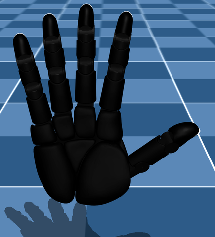](examples/mujoco/01_load_and_view.py) | [](examples/mujoco_warp/01_load_and_step.py) | [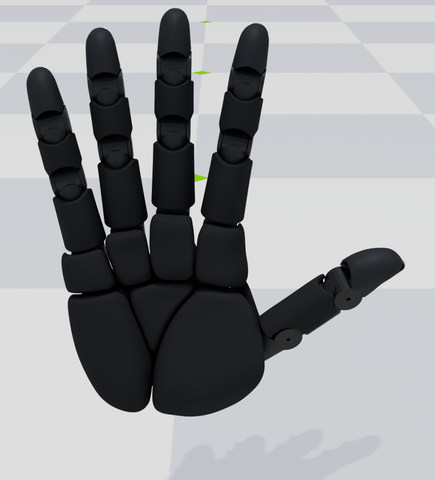](examples/isaaclab/01_load_and_view.py) | [motrixsim/01_load_and_view.py](examples/motrixsim/01_load_and_view.py) |
| 02 | Preset poses | [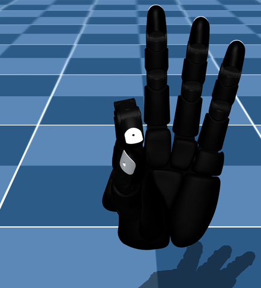](examples/mujoco/02_preset_poses.py) | [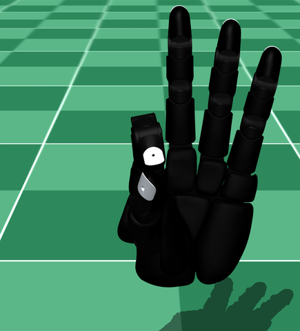](examples/mujoco_warp/02_preset_poses.py) | [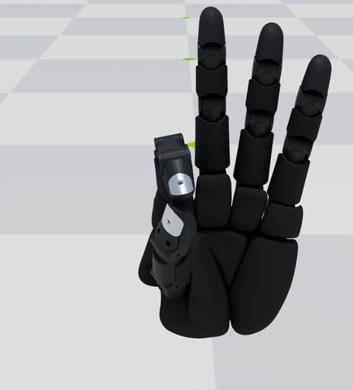](examples/isaaclab/02_preset_poses.py) | [motrixsim/02_preset_poses.py](examples/motrixsim/02_preset_poses.py) |
| 03 | MIT tracking | [](examples/mujoco/03_mit_tracking.py) | [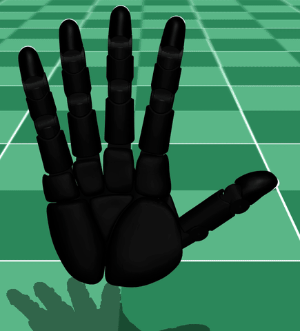](examples/mujoco_warp/03_mit_tracking.py) | [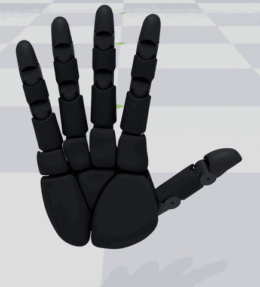](examples/isaaclab/03_mit_tracking.py) | [motrixsim/03_mit_tracking.py](examples/motrixsim/03_mit_tracking.py) |
| 04 | Joint sweep | [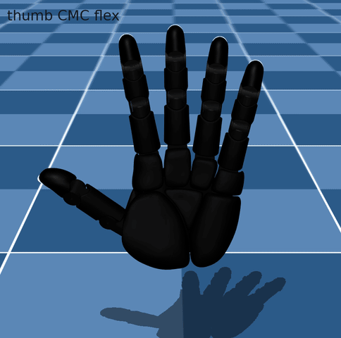](examples/mujoco/04_sweep_joints.py) | [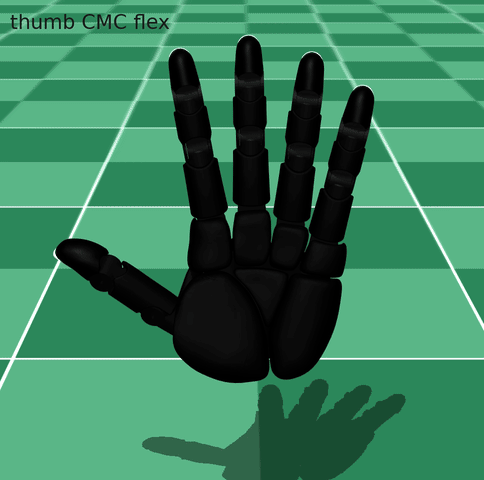](examples/mujoco_warp/04_sweep_joints.py) | [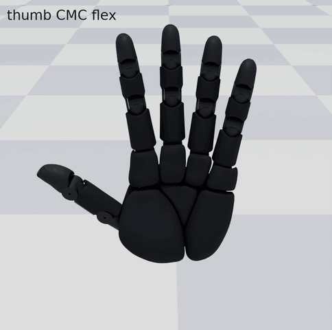](examples/isaaclab/04_sweep_joints.py) | [motrixsim/04_sweep_joints.py](examples/motrixsim/04_sweep_joints.py) |
| 05 | Parallel environments | — | [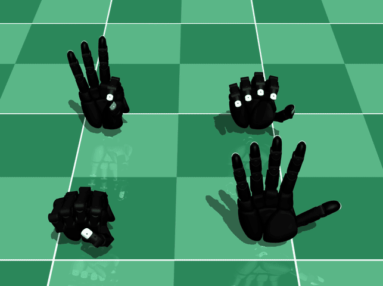](examples/mujoco_warp/05_multi_world.py) | [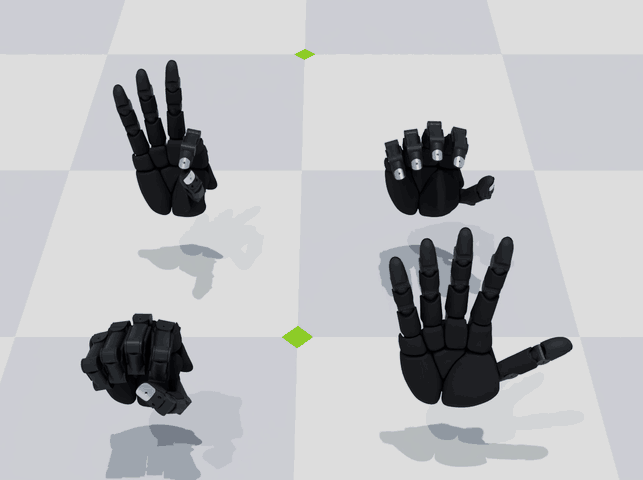](examples/isaaclab/05_parallel_envs.py) | [motrixsim/05_multi_world.py](examples/motrixsim/05_multi_world.py) |
| 06 | Pen spin | [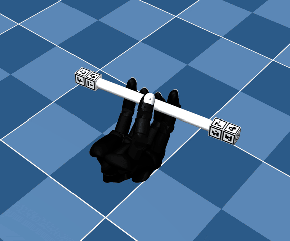](examples/mujoco/06_pen_spin.py) | [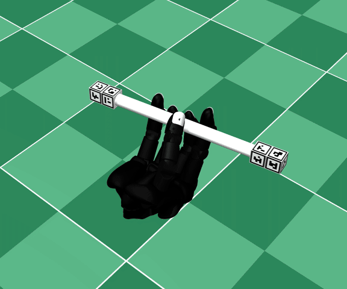](examples/mujoco_warp/06_pen_spin.py) | [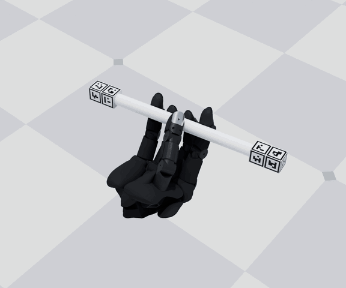](examples/isaaclab/06_pen_spin.py) | [motrixsim/06_pen_spin.py](examples/motrixsim/06_pen_spin.py) |

— : no example for this simulator.

Every example takes `--hand left` or `--hand right`, except 06, which replays a right-hand policy and takes only
`--hand right`. Long descriptions, per-simulator commands, flags and the run record format are in
[examples/README.md](examples/README.md).

## Control Mode

wuji-sim uses the `mit_v2` control mode of the Wuji Hand 2 SDK. Gains and torques use the same physical units as the SDK, so no unit conversion is needed between the real hand and simulation.

|Quantity|Meaning|Unit|
|---|---|---|
|`kp`|stiffness|N·m/rad|
|`kd`|damping|N·m·s/rad|
|`tau_ff`|feed-forward torque|N·m|
|`tau_limit`|joint torque limit|N·m|

Each simulator applies them directly, with no unit conversion:

```
tau = clip(kp * (q_des - q) + kd * (qd_des - qd) + tau_ff, -tau_limit, tau_limit)
```

The examples use `kp = 1.0` and `kd = 0.03` on every joint.

SDK names: Python `ControlMode.MitV2`, C `WUJI_CONTROL_MODE_MIT_V2`, mode string `"mit_v2"`.

## Requirements

| Simulator | Version | Pixi environment | Timestep | GPU |
| :--- | :--- | :--- | :--- | :--- |
| MuJoCo | mujoco 3.11.0 | `mujoco` | 0.005 s | Not needed |
| MuJoCo Warp | mujoco-warp 3.11.0, warp-lang 1.17.0 | `mujoco-warp` | 0.005 s | NVIDIA GPU with CUDA |
| MotrixSim | motrixsim 1.0.0 | `motrixsim` | 0.005 s | Not needed |
| Isaac Lab | Isaac Lab 3.0.0 on Isaac Sim 6.2.0.0 | `isaaclab` | 0.005 s | NVIDIA RTX GPU |

- The `mujoco` and `mujoco-warp` environments resolve Python 3.11; `isaaclab` resolves Python 3.12
  (Isaac Lab 3.0's requirement).
- Every environment builds for one platform: Linux x86-64 (`linux-64`) with glibc 2.35 or newer, for example
  Ubuntu 22.04 or later. Installing needs Pixi 0.84.1 or newer; older Pixi versions stop with an error asking
  you to update Pixi (`pixi self-update`).
- The hand model is the `wuji-hand2-2-description` 2026.11.18 package (the glove version of `hand2_2`, released
  from wuji-description `v2026.11.18`), pinned in `pixi.lock`; its digest is pinned in `assets-expected.toml`.
- MuJoCo Warp compiles and runs its `warp-lang` kernels on a CUDA device; tests that need the GPU are marked
  `gpu`.
- The `mujoco` and `mujoco-warp` environments render offscreen through EGL (`MUJOCO_GL=egl` by default). On a
  machine without an NVIDIA GPU driver they need Mesa's software EGL; on Ubuntu:
  `sudo apt-get install libegl1 libopengl0`.
- The `isaaclab` environment installs Isaac Lab 3.0.0, Isaac Sim 6.2.0.0 and PyTorch 2.11.0 (CUDA 13.0
  wheels) from the public NVIDIA and PyTorch package indexes. It needs an NVIDIA RTX GPU that meets the
  [Isaac Sim 6.2.0 requirements](https://docs.isaacsim.omniverse.nvidia.com/6.2.0/installation/requirements.html),
  and an NVIDIA Linux driver of 595.58.03 or newer; GPUs without RT cores, such as A100 and H100, are not
  supported.
- **NVIDIA EULA:** Isaac Sim asks you to accept the
  [NVIDIA Omniverse License Agreement](https://docs.omniverse.nvidia.com/platform/latest/common/NVIDIA_Omniverse_License_Agreement.html)
  the first time it starts. Read it before you accept. To accept it without the prompt, set
  `OMNI_KIT_ACCEPT_EULA=YES` in the shell that runs Isaac Sim; this repository never sets it for you.

## Known Limitations
- **Not identified:** joint friction and passive damping are set to zero.
- **Not modeled:** the thumb's angle-dependent static torque, tactile sensing, and motor and firmware dynamics.
- **Torque limits** are per-joint estimates, not yet confirmed on hardware.
- **Isaac Lab:** `tau_ff` must be zero, because the PhysX joint drive has no feed-forward torque input.

Simulator details: [docs/platforms.md](docs/platforms.md).

## Release Notes

The changes in each release are listed on the [release notes page](https://docs.wuji.tech/docs/en/release-notes) of the Wuji Docs Center.

## Related
- [wuji-description](https://github.com/wuji-technology/wuji-description): the hand models, also on PyPI as [`wuji-hand2-2-description`](https://pypi.org/project/wuji-hand2-2-description/).
- [Wuji Docs Center](https://docs.wuji.tech): product documentation.
- [examples/README.md](examples/README.md) and [docs/platforms.md](docs/platforms.md): commands and platform notes.

## Contact

For any questions, please contact [support@wuji.tech](mailto:support@wuji.tech).
