# wuji-sim

[](LICENSE)
[](https://github.com/wuji-technology/wuji-sim/releases)

[English](README.md)

<p>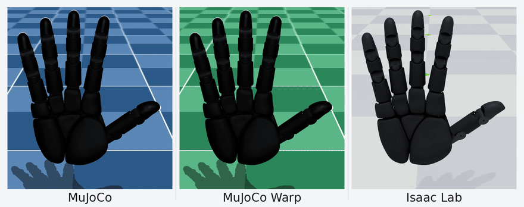</p>

**wuji-sim 是 Wuji Hand 2 的官方仿真配置。**

要让仿真手表现得像真机，需要仔细配置。wuji-sim 为 MuJoCo、MuJoCo Warp 和 Isaac Lab 提供一套经过检查的最小配置，下方的支持矩阵列出了每个仿真器检查了哪些内容。你可以在此基础上构建自己的任务；后续将支持更多仿真器。Wuji Hand 2 是一只五指、20 个驱动关节的灵巧手；本仓库中的 PD 增益和关节参数按真机在 MIT 控制下的行为设置（见[控制模式](#控制模式)）。

## 目录

- [支持矩阵](#支持矩阵)
- [快速开始](#快速开始)
- [示例](#示例)
- [控制模式](#控制模式)
- [环境要求](#环境要求)
- [已知局限](#已知局限)
- [发布记录](#发布记录)
- [相关链接](#相关链接)
- [联系我们](#联系我们)

## 支持矩阵

| | MuJoCo | MuJoCo Warp | Isaac Lab |
| :--- | :--- | :--- | :--- |
| 测试版本 | mujoco 3.11.0 | mujoco-warp 3.11.0, warp-lang 1.17.0 | Isaac Lab 3.0.0, Isaac Sim 6.2.0.0 |
| 资产 | MJCF | MJCF | USD |
| 控制模式 | MIT | MIT | MIT |
| 运动学（指尖位置） | Sim-checked | Sim-checked | Sim-checked |
| 惯量 | Sim-checked | Sim-checked | Sim-checked |
| 自碰撞（测试动作） | Sim-checked | Sim-checked | Sim-checked |
| 关节跟踪（空载） | Real-to-sim compared | Real-to-sim compared | Real-to-sim compared |
| 关节跟踪（负载） | Not validated | Not validated | Not validated |
| 指尖力 | Not validated | Not validated | Not validated |
| 关节力矩限制 | Not validated | Not validated | Not validated |

- **Sim-checked** — 仅在仿真中检查，未在真机上检查。
- **Real-to-sim compared** — 把真机采集的指令在仿真中重放，并报告误差；未设验收阈值。
- **Not validated** — 尚未检查。

<p>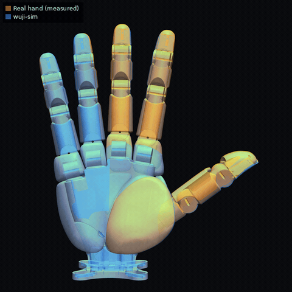</p>

真机右手（琥珀色）与 wuji-sim（蓝色）均为半透明，执行同一指令序列；重合处颜色混合，偏差处颜色分开。

## 快速开始

### 1. 安装

wuji-sim 使用 [Pixi](https://pixi.sh) 0.84.1 或更新版本，运行于 glibc 2.35 或更新版本的 Linux x86-64（如 Ubuntu 22.04
或更新版本）。按需安装各仿真器的环境：

```bash
git clone https://github.com/wuji-technology/wuji-sim.git
cd wuji-sim

pixi install --locked -e mujoco        # MuJoCo (CPU)
pixi install --locked -e mujoco-warp   # MuJoCo Warp (NVIDIA GPU)
pixi install --locked -e isaaclab      # Isaac Lab on Isaac Sim (NVIDIA RTX GPU)
```

每个环境都会同时安装手部模型（`wuji-hand2-2-description`）。

### 2. 每个仿真器运行一个示例

#### MuJoCo

```bash
pixi run -e mujoco python examples/mujoco/01_load_and_view.py --hand right
```

#### MuJoCo Warp

需要带 CUDA 的 NVIDIA GPU。

```bash
pixi run -e mujoco-warp python examples/mujoco_warp/01_load_and_step.py --hand right
```

#### Isaac Lab

需要 NVIDIA RTX GPU；Isaac Sim 首次启动时会要求接受 NVIDIA Omniverse EULA（见[环境要求](#环境要求)）。

```bash
pixi run -e isaaclab python examples/isaaclab/01_load_and_view.py --hand right
```

示例默认打开查看器窗口，并写一份小的 JSON 运行记录；在自动化或没有显示器的机器上，加 `--headless`
即可不开窗口运行，同时还会写出图片、视频和 CSV 文件。每次运行都会打印 `record: <path>.json`，并按启动时间写一份新记录，运行之间互不覆盖，也无需清理。不指定 `--output-dir`
时，输出写入仓库根目录下的 `artifacts/runs-<YYYYMMDD>/`；代码不在 git 仓库中时，写入当前目录下的 `artifacts/runs-<YYYYMMDD>/`。全部命令、参数和输出见
[examples/README.md](examples/README.md)。

## 示例

| # | 示例 | MuJoCo | MuJoCo Warp | Isaac Lab |
| :--- | :--- | :---: | :---: | :---: |
| 01 | 加载与查看 | [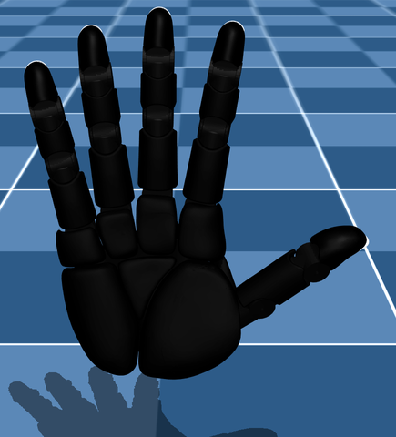](examples/mujoco/01_load_and_view.py) | [](examples/mujoco_warp/01_load_and_step.py) | [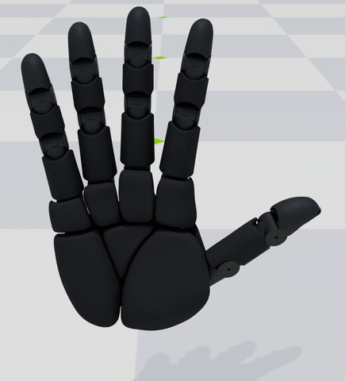](examples/isaaclab/01_load_and_view.py) |
| 02 | 预设姿态 | [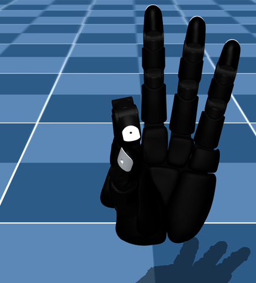](examples/mujoco/02_preset_poses.py) | [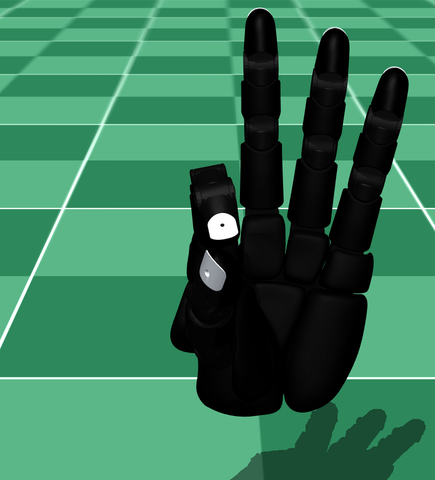](examples/mujoco_warp/02_preset_poses.py) | [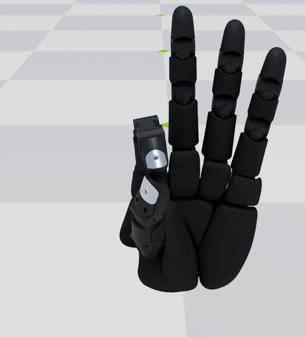](examples/isaaclab/02_preset_poses.py) |
| 03 | MIT 跟踪 | [](examples/mujoco/03_mit_tracking.py) | [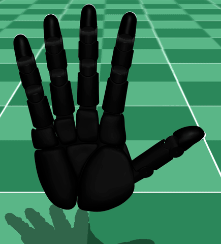](examples/mujoco_warp/03_mit_tracking.py) | [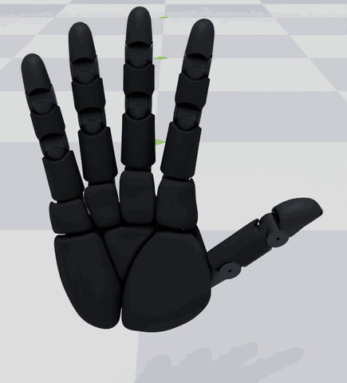](examples/isaaclab/03_mit_tracking.py) |
| 04 | 关节扫动 | [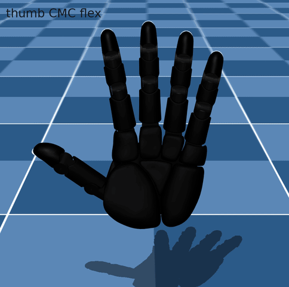](examples/mujoco/04_sweep_joints.py) | [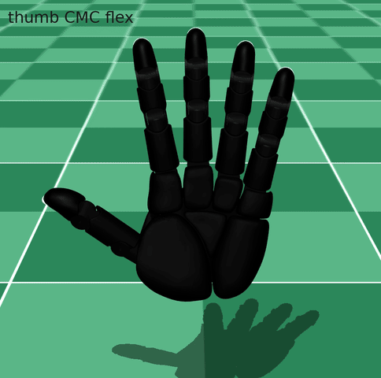](examples/mujoco_warp/04_sweep_joints.py) | [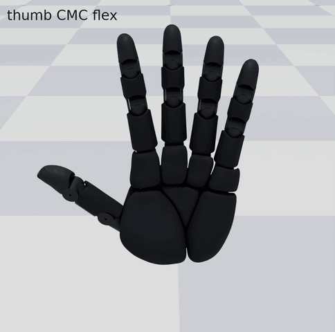](examples/isaaclab/04_sweep_joints.py) |
| 05 | 并行环境 | — | [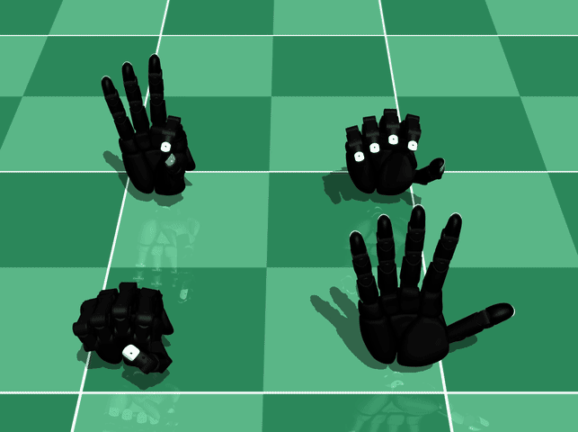](examples/mujoco_warp/05_multi_world.py) | [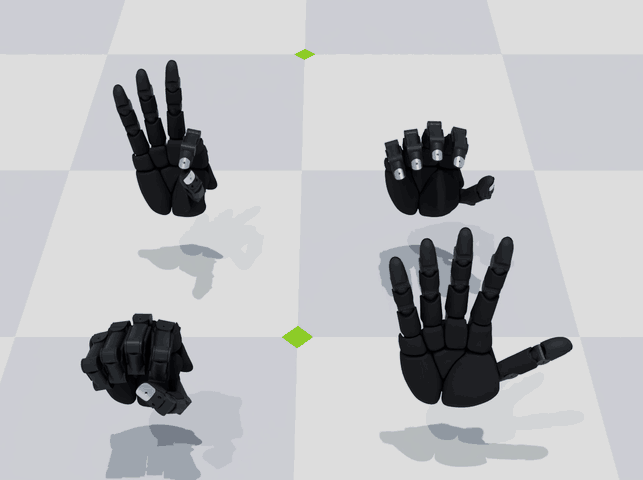](examples/isaaclab/05_parallel_envs.py) |
| 06 | 转笔 | [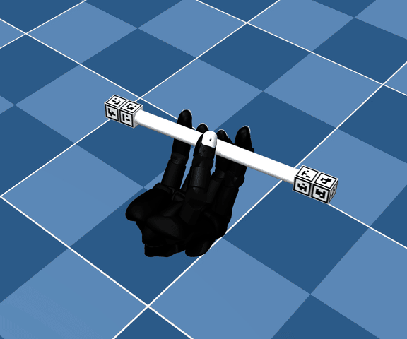](examples/mujoco/06_pen_spin.py) | [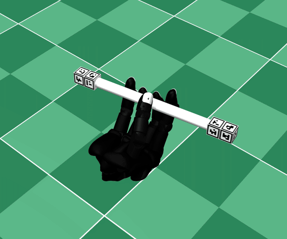](examples/mujoco_warp/06_pen_spin.py) | [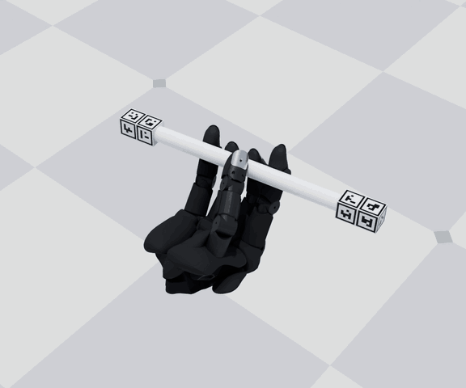](examples/isaaclab/06_pen_spin.py) |

—：该仿真器没有此示例。

每个示例都接受 `--hand left` 或 `--hand right`；06 回放的是右手策略，只接受 `--hand right`。完整说明、各仿真器的命令、参数和运行记录格式见
[examples/README.md](examples/README.md)。

## 控制模式

wuji-sim 使用 Wuji Hand 2 SDK 的 `mit_v2` 控制模式。增益和力矩使用与 SDK 相同的物理单位，真机和仿真之间不需要做单位换算。

|量|含义|单位|
|---|---|---|
|`kp`|刚度|N·m/rad|
|`kd`|阻尼|N·m·s/rad|
|`tau_ff`|前馈力矩|N·m|
|`tau_limit`|关节力矩上限|N·m|

各仿真器直接应用这些值，不做单位换算：

```
tau = clip(kp * (q_des - q) + kd * (qd_des - qd) + tau_ff, -tau_limit, tau_limit)
```

示例对所有关节取 `kp = 1.0`、`kd = 0.03`。

SDK 中的名称：Python `ControlMode.MitV2`，C `WUJI_CONTROL_MODE_MIT_V2`，模式字符串 `"mit_v2"`。

## 环境要求

| 仿真器 | 版本 | Pixi 环境 | 时间步 | GPU |
| :--- | :--- | :--- | :--- | :--- |
| MuJoCo | mujoco 3.11.0 | `mujoco` | 0.005 s | 不需要 |
| MuJoCo Warp | mujoco-warp 3.11.0、warp-lang 1.17.0 | `mujoco-warp` | 0.005 s | 带 CUDA 的 NVIDIA GPU |
| Isaac Lab | Isaac Lab 3.0.0，运行于 Isaac Sim 6.2.0.0 | `isaaclab` | 0.005 s | NVIDIA RTX GPU |

- `mujoco` 和 `mujoco-warp` 环境解析到 Python 3.11；`isaaclab` 环境解析到 Python 3.12（Isaac Lab 3.0
  的要求）。
- 所有环境只为一个平台构建：glibc 2.35 或更新版本的 Linux x86-64（`linux-64`），如 Ubuntu 22.04 或更新版本。
  安装需要 Pixi 0.84.1 或更新版本；更旧的 Pixi 会报错退出，提示更新 Pixi（`pixi self-update`）。
- 手部模型是 `wuji-hand2-2-description` 2026.11.18 包（`hand2_2` 的手套版本，发布自 wuji-description
  `v2026.11.18`），版本锁定在 `pixi.lock` 中；其摘要固定在 `assets-expected.toml` 中。
- MuJoCo Warp 在 CUDA 设备上编译并运行 `warp-lang` 内核；需要 GPU 的测试标记为 `gpu`。
- `mujoco` 与 `mujoco-warp` 环境通过 EGL 离屏渲染（默认 `MUJOCO_GL=egl`）。在没有 NVIDIA GPU 驱动的机器上，需要安装
  Mesa 软件 EGL；Ubuntu 上为 `sudo apt-get install libegl1 libopengl0`。
- `isaaclab` 环境从公开的 NVIDIA 与 PyTorch 软件包索引安装 Isaac Lab 3.0.0、Isaac Sim 6.2.0.0 和 PyTorch 2.11.0
  （CUDA 13.0 wheel）。它需要驱动版本不低于 595.58.03 的 NVIDIA Linux 驱动，以及满足
  [Isaac Sim 6.2.0 要求](https://docs.isaacsim.omniverse.nvidia.com/6.2.0/installation/requirements.html)的 NVIDIA RTX
  GPU；不支持没有 RT Core 的 GPU（如 A100、H100）。
- **NVIDIA EULA：** Isaac Sim 首次启动时会要求接受
  [NVIDIA Omniverse License Agreement](https://docs.omniverse.nvidia.com/platform/latest/common/NVIDIA_Omniverse_License_Agreement.html)。
  接受前请先阅读。若要跳过提示直接接受，在运行 Isaac Sim 的 shell 中设置 `OMNI_KIT_ACCEPT_EULA=YES`；本仓库不会替你设置。

## 已知局限
- **未识别：** 关节摩擦和被动阻尼设为零。
- **未建模：** 拇指随关节角度变化的静态力矩、触觉，以及电机与固件动力学。
- **关节力矩限制**是逐关节的估计值，尚未经硬件确认。
- **Isaac Lab：** `tau_ff` 必须为零，因为 PhysX 关节驱动没有前馈力矩输入。

仿真器细节见 [docs/platforms.md](docs/platforms.md)。

## 发布记录

各版本的变更见 Wuji Docs Center 的[发布记录](https://docs.wuji.tech/docs/en/release-notes)页面。

## 相关链接
- [wuji-description](https://github.com/wuji-technology/wuji-description)：手部模型，也以 [`wuji-hand2-2-description`](https://pypi.org/project/wuji-hand2-2-description/) 发布在 PyPI 上。
- [Wuji Docs Center](https://docs.wuji.tech)：产品文档。
- [examples/README.md](examples/README.md) 和 [docs/platforms.md](docs/platforms.md)：命令与平台说明。

## 联系我们

如有任何问题，请联系 [support@wuji.tech](mailto:support@wuji.tech)。
