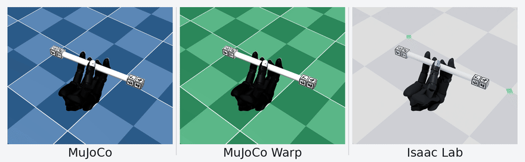

# Examples

Every example takes `--hand left` or `--hand right`, except 06, which supports the right hand only.
MIT gains use the physical units of the SDK `mit_v2` control mode; see [Control Mode](../README.md#control-mode).
This repository does not provide tools for driving a real hand.

## Running

Install the environments as in the [Quick Start](../README.md#quick-start), then run the commands below from the
repository root. Each command opens a viewer window; add `--headless` to write files instead (see
[Outputs](#outputs)). Replace `--hand right` with `--hand left` for the left hand, except in 06.

MuJoCo and MotrixSim run on the CPU, MuJoCo Warp needs an NVIDIA GPU with CUDA, and Isaac Lab needs an NVIDIA
RTX GPU (see [Requirements](../README.md#requirements)).

### 01 Load and view

The hand model loaded into the scene with a fixed wrist.

```bash
pixi run -e mujoco python examples/mujoco/01_load_and_view.py --hand right
pixi run -e mujoco-warp python examples/mujoco_warp/01_load_and_step.py --hand right
pixi run -e isaaclab python examples/isaaclab/01_load_and_view.py --hand right
pixi run -e motrixsim python examples/motrixsim/01_load_and_view.py --hand right
```

### 02 Preset poses

A cycle through the preset poses `open`, `half_grip`, `fist` and `pinch`.

```bash
pixi run -e mujoco python examples/mujoco/02_preset_poses.py --hand right
pixi run -e mujoco-warp python examples/mujoco_warp/02_preset_poses.py --hand right
pixi run -e isaaclab python examples/isaaclab/02_preset_poses.py --hand right
pixi run -e motrixsim python examples/motrixsim/02_preset_poses.py --hand right
```

### 03 MIT tracking

MIT torque control tracking a sequence of preset poses.

```bash
pixi run -e mujoco python examples/mujoco/03_mit_tracking.py --hand right
pixi run -e mujoco-warp python examples/mujoco_warp/03_mit_tracking.py --hand right
pixi run -e isaaclab python examples/isaaclab/03_mit_tracking.py --hand right
pixi run -e motrixsim python examples/motrixsim/03_mit_tracking.py --hand right
```

### 04 Joint sweep

MIT torque control sweeping every joint between its inner limits.

```bash
pixi run -e mujoco python examples/mujoco/04_sweep_joints.py --hand right
pixi run -e mujoco-warp python examples/mujoco_warp/04_sweep_joints.py --hand right
pixi run -e isaaclab python examples/isaaclab/04_sweep_joints.py --hand right
pixi run -e motrixsim python examples/motrixsim/04_sweep_joints.py --hand right
```

### 05 Parallel environments

Four hands in parallel, each running the 03 sequence from a staggered start pose. MuJoCo has no 05 example.

```bash
pixi run -e mujoco-warp python examples/mujoco_warp/05_multi_world.py --hand right
pixi run -e isaaclab python examples/isaaclab/05_parallel_envs.py --hand right
pixi run -e motrixsim python examples/motrixsim/05_multi_world.py --hand right
```

### 06 Pen spin

The pen-spinning policy published with release `v2026.10.22` of
[wuji-mjlab](https://github.com/wuji-technology/wuji-mjlab), replayed on the right hand under wuji-sim's own hand
model and simulator settings; the pen turns about two and a half times. The first run downloads the release archive
(about 250 MB) into the cache directory and checks it before use.

```bash
pixi run -e mujoco python examples/mujoco/06_pen_spin.py --hand right
pixi run -e mujoco-warp python examples/mujoco_warp/06_pen_spin.py --hand right
pixi run -e isaaclab python examples/isaaclab/06_pen_spin.py --hand right
pixi run -e motrixsim python examples/motrixsim/06_pen_spin.py --hand right
```

<p></p>

## Options

| Option | Meaning |
| :--- | :--- |
| `--hand {left,right}` | Required; the hand to load. |
| `--headless` | Skip the viewer window and write the files described under [Outputs](#outputs) instead. |
| `--asset-root PATH` | `hand2/hand2_2/body` directory of a `wuji-description` checkout (default: `$WUJI_DESCRIPTION_ROOT`, else the installed `wuji-hand2-2-description` package). |
| `--strict` | Fail instead of warning when the hand model's digest differs from the expected one. |
| `--output-dir PATH` | Directory for the run record and files (default: `artifacts/runs-<YYYYMMDD>/`). |
| `--nworld N` | MuJoCo Warp 05 only; number of worlds (default 4). |
| `--num-envs N` | Isaac Lab 05 only; number of environments (default 4). |
| `--cache-dir PATH` | 06 only; where the release archive is cached (default: `$XDG_CACHE_HOME/wuji-sim`, else `~/.cache/wuji-sim`). |
| `--write-trajectory` | MuJoCo 03 only, with `--headless`; also write the tracked trajectory as CSV. |
| `--reference-trajectory PATH` | Isaac Lab 03 and 04 only, with `--headless`; compare the run with a CSV from another simulator's run. |

## Outputs

Every run writes a JSON record of its settings, versions and results to `artifacts/runs-<YYYYMMDD>/` (or
`--output-dir`) and prints its path. `--headless` also writes the example's images, videos or CSV files next to it.
Runs never overwrite earlier files.
